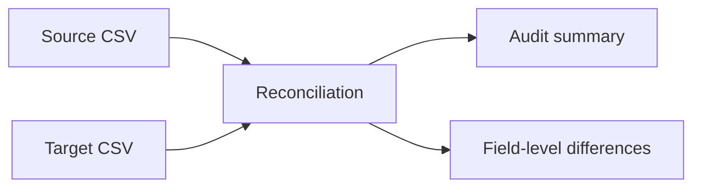

# ERP Migration Reconciliation — Portfolio Demonstration

A **sanitized example** showing how to validate a migration between business systems. Inspired by my role in integrations and migrations of 500,000+ enterprise records, but **not the employer's actual migration script**.

## Features
- Compare source and target exports using a stable record ID
- Detect missing records, unexpected records and changed business fields
- Produce JSON summary and a discrepancy CSV
- Unit tests; only Python standard library

## Run
```bash
python src/reconcile.py --source data/source.csv --target data/target.csv --report out/report.json --differences out/differences.csv
python -m unittest discover -s tests -v
```

## Architecture


## Production considerations
Stable IDs, idempotent sync, field mappings, API rate limits, retries, audit trails, PII handling and access controls.

All names and records in `data/` are fictional. No company exports, authentication secrets or internal endpoints.
